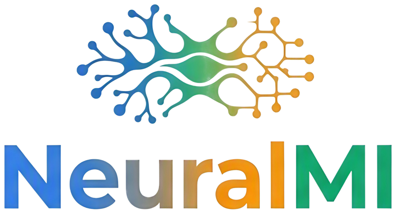
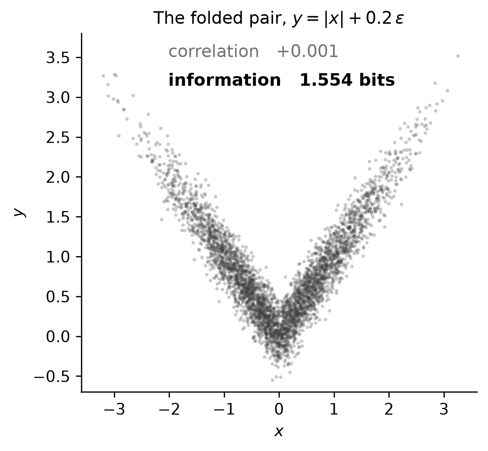
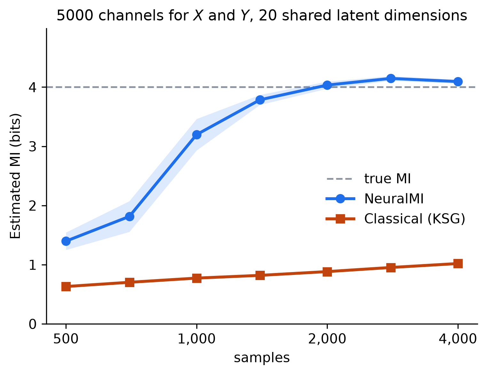
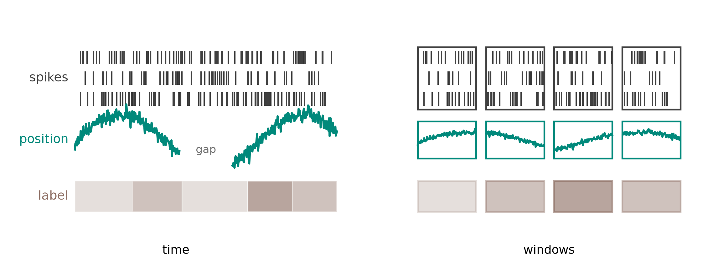
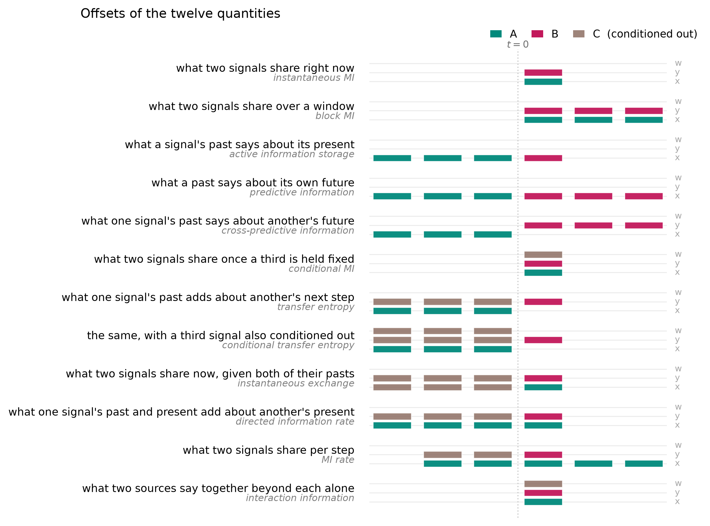

<p align="center"></p>

# NeuralMI: information-theoretic analysis of neural data at scale

[](https://eslam-abdelaleem.github.io/NeuralMI/)
[](https://opensource.org/licenses/MIT)
[](https://github.com/eslam-abdelaleem/NeuralMI/actions/workflows/tests.yml)

**NeuralMI brings information-theoretic analysis to the scale of modern neuroscience using neural-network-based information estimators.**




Correlation is the usual way to ask whether two signals are related or not. However, it can be blind to a nonlinear relationship. For example, a Gaussian folded about zero has a perfect relationship between $x$ and $y$ and zero correlation because the two halves of the linear trend cancel exactly.


Mutual information detects that relationship because it captures linear and nonlinear dependencies alike. With it you can also ask questions that a correlation has no form for: how much a population's past says about its own future, what one area adds about another beyond what that area already predicts of itself, or what a pair of signals carries that neither carries alone.




The obstacle to applying information-theoretic measures to large, multimodal neuroscience datasets is the curse of dimensionality. Classical estimators need more samples the more dimensions they are given. Past about ten dimensions, they need more samples than any recording of realistic size contains. Information-theoretic analysis has mostly been limited to a handful of channels for that reason.

Neural-network-based estimators overcome this by learning a map into a low-dimensional embedding while estimating the information in it. The number of samples needed then depends on the latent structure of the data rather than on the number of channels.


Giving each modality its own encoder also lets spike times, tracked trajectories and trial labels be analysed together on one timeline. Each modality is processed in its own subspace by an encoder with its own inductive bias.




Once estimation is possible at that scale, the whole family of information
quantities can be estimated from a single primitive. Every quantity in the library is
the same conditional mutual information $I(A;B \mid C)$ under a different choice
of inputs and time offsets.



## Installation

<!-- install-start -->
> **Jupyter / Colab users:** prefix each shell command with `!`.

```bash
git clone https://github.com/eslam-abdelaleem/NeuralMI.git
cd NeuralMI

pip install .

# Optional extras (combine them as in ".[viz,tutorials]"):
#   pip install ".[viz]"        # PCA, t-SNE and UMAP plots of the embeddings
#   pip install ".[vision]"     # pretrained image networks as encoders
#   pip install ".[tutorials]"  # JupyterLab, to run the tutorials
#   pip install ".[docs]"       # the docs toolchain (building also needs pandoc)
#   pip install ".[test]"       # the test suite

# Developers (editable install with all of the above):
pip install -e ".[dev]"
```
<!-- install-end -->


## Quickstart

<!-- quickstart-start -->
```python
import neural_mi as nmi
from neural_mi import Split

x, y = nmi.generators.generate_correlated_gaussians(
    n_samples=2000, dim=5, mi=2.0, seed=0)

result = nmi.run(
    x, y,
    mode='estimate',
    split=Split(mode='random'),   # for independent samples
    seed=0,
)

print(f"estimate : {result.mi_estimate:.3f} bits")
print(f"exact    : 2.000 bits")
```

```
estimate : 1.986 bits
exact    : 2.000 bits
```
<!-- quickstart-end -->

## Tutorials

| notebook | what it covers |
|---|---|
| [01 Why information](tutorials/01_Why_Information.ipynb) | What mutual information detects that correlation misses, and where classical estimators stop working |
| [02 Your first number](tutorials/02_Your_First_Number.ipynb) | What an estimate is and what determines its accuracy |
| [03 Which quantity](tutorials/03_Which_Quantity.ipynb) | Twelve quantities as one $I(A;B \mid C)$ primitive under different offset patterns |
| [04 Preparing your data](tutorials/04_Preparing_Your_Data.ipynb) | How to turn a recording into tensors and split them for training and evaluation |
| [05 Choosing the estimator and the architecture](tutorials/05_Estimator_And_Architecture.ipynb) | When to change the estimator, the critic or the encoder, and how to supply your own encoder |

## Further reading

| document | answers |
|---|---|
| [`USING.md`](reference/USING.md) | how to call each analysis and read what comes back |
| [`PARAMETERS.md`](reference/PARAMETERS.md) | every setting and its default |
| [`THEORY.md`](reference/THEORY.md) | what the numbers mean and why the estimators behave as they do |
| [`MESSAGES.md`](reference/MESSAGES.md) | what each warning that the library prints means |
| [`ANATOMY.md`](reference/ANATOMY.md) | what an estimator is, built from scratch in PyTorch |
| [`INTERNALS.md`](reference/INTERNALS.md) | where the code lives and how to extend it |
| [`TESTING.md`](reference/TESTING.md) | what the test suite covers |

## Citing

Please cite the library in addition to the paper behind each part of NeuralMI that you used.

| you used | please cite |
|-|-----|
| the estimators, `mode='rigorous'` | Eslam Abdelaleem\*, K. Michael Martini\* and Ilya Nemenman. [Accurate estimation of mutual information in high dimensional data](https://arxiv.org/abs/2506.00330). arXiv:2506.00330, 2025. |
| `mode='dimensionality'` | Paarth Gulati\*, Eslam Abdelaleem\*, Audrey Sederberg and Ilya Nemenman. [Mutual information and task-relevant latent dimensionality](https://proceedings.mlr.press/v326/gulati26a.html). *Proceedings of GRaM*, PMLR 326:262-293, 2026. |
| variational encoders and decoders | Eslam Abdelaleem*, Ilya Nemenman and K. Michael Martini*. [Deep variational multivariate information bottleneck: a framework for variational losses](http://jmlr.org/papers/v26/24-0204.html). *Journal of Machine Learning Research* 26, 2025. |
| `mode='precision'` | Leo Wood, Eslam Abdelaleem, Audrey Sederberg and Simon Sponberg. Hawkmoth descending neurons carry motor information in spike timing across synergistic populations. In preparation. |
| analyses of neural populations at scale | Eslam Abdelaleem et al. Information-theoretic analysis of neural populations at scale. In preparation. |


## Questions and problems

See the [issue tracker](https://github.com/eslam-abdelaleem/NeuralMI/issues).

## Contributing

See [`CONTRIBUTING.md`](CONTRIBUTING.md).

## License

See [`LICENSE`](LICENSE).
