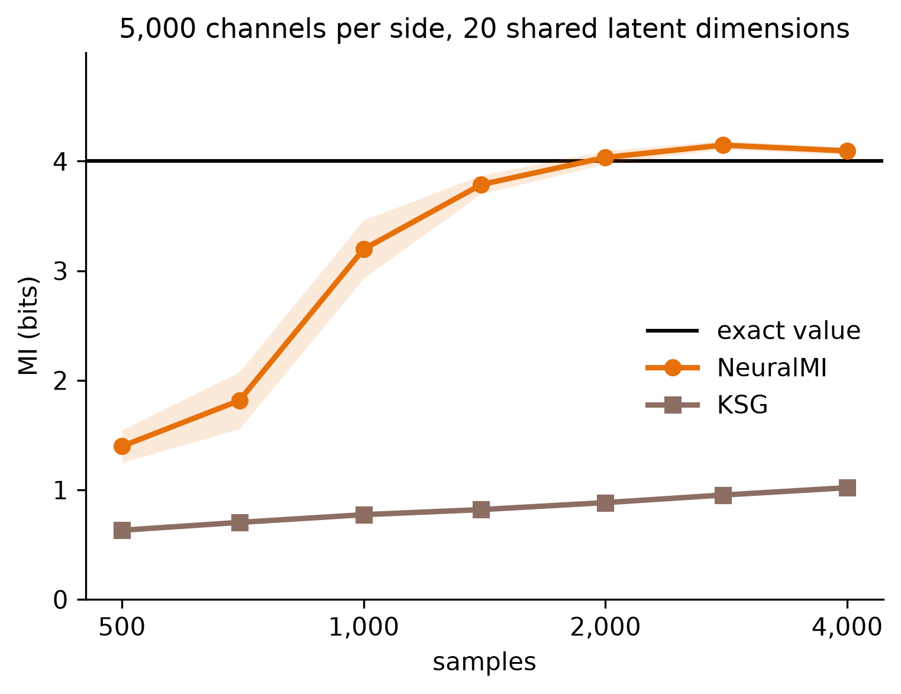

NeuralMI
========

**NeuralMI brings information-theoretic analysis to the scale of modern
neuroscience using neural-network-based information estimators.**

Mutual information measures in bits how much two recordings share, including
the dependencies that a correlation reports as zero. With it you can also ask
questions that a correlation has no form for, such as how much a population's
past says about its own future or what a pair of signals carries that neither
carries alone.

Classical estimators need more samples the more dimensions they are given. Past
roughly ten dimensions, they need more samples than any recording that you are
likely to have. A neural estimator first learns a map into a low-dimensional
embedding, so the number of samples that you need depends on the structure in
the data rather than on the number of channels.

Both sides above are five thousand channels wide and share twenty latent
dimensions that carry exactly four bits. NeuralMI comes close to the four bits
with fewer samples than channels. On the same data, KSG stays far below them
and barely changes as the number of samples grows.

Every analysis goes through the one function ``nmi.run()`` with a ``mode`` that
selects the quantity.

Where to start
--------------

:doc:`getting_started` explains how to install the library and computes one
estimate from start to finish. The :doc:`tutorials` are five notebooks that are
meant to be read in order. :doc:`api_reference` documents the public functions
and classes. The source is on `GitHub
<https://github.com/eslam-abdelaleem/NeuralMI>`_.

The reference section has seven pages:

- :doc:`USING` shows the call for each task and how to read what comes back.
- :doc:`PARAMETERS` lists every setting with its default.
- :doc:`THEORY` explains what the reported numbers mean and why the estimators
  behave as they do.
- :doc:`MESSAGES` explains every warning that the library prints. Each entry
  starts with the text of its warning.
- :doc:`ANATOMY` builds an estimator from scratch in a few dozen lines of
  PyTorch.
- :doc:`INTERNALS` maps the codebase and explains how to extend it.
- :doc:`TESTING` describes what the test suite checks.

.. toctree::
   :maxdepth: 2
   :caption: Using the library

   getting_started
   tutorials
   api_reference

.. toctree::
   :maxdepth: 1
   :caption: Reference

   USING
   PARAMETERS
   THEORY
   MESSAGES
   ANATOMY
   INTERNALS
   TESTING

.. toctree::
   :maxdepth: 1
   :caption: Project

   CONTRIBUTING
   LICENSE
